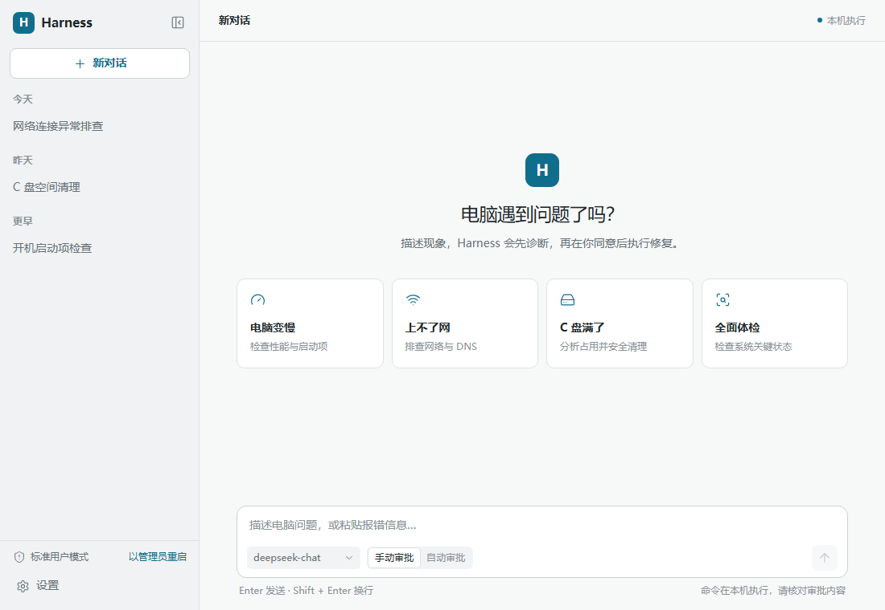

# Harness 电脑维修助手

Harness 是一款基于 **Rust + Tauri 2 + React + TypeScript** 的 Windows 中文桌面维修助手。它通过 OpenAI 兼容的大模型接口，将自然语言描述的电脑问题转化为可审查、可审批、可追踪的本机诊断与修复流程。

应用不仅生成排查建议，还能在用户授权后调用系统工具、执行命令、读取诊断信息并持续根据结果调整方案。所有模型工具调用均由 Rust 后端进行风险判断和审批控制。



## 核心功能

- **OpenAI 兼容接口**：支持 Chat Completions 与 Responses 协议，可获取模型列表、测试连接并使用自定义模型。
- **Kilo 免费模型插件**：无需登录或 API Key，可从插件页一键添加；仅展示上游明确标记为免费的模型，并沿用现有流式对话与工具调用链。
- **Agent 诊断循环**：支持流式正文与推理内容、工具结果回传、最多 25 步执行、主动停止及会话自动保存。
- **本机维修工具**：覆盖 CMD、PowerShell、WSL、Python、系统信息、进程、服务、事件日志、文件和注册表等能力。
- **风险分级审批**：区分只读、系统修改、下载安装和破坏性操作；高风险操作由后端强制审批，必要时要求二次确认。
- **执行保护**：非交互命令、实时输出、中文编码处理、超时控制、结果截断及进程树回收。
- **会话管理**：新建、重命名、删除、恢复和导出 Markdown；可复制消息并查看用户消息对应的实际提示词。
- **中文桌面界面**：提供浅色/深色主题、工具状态卡片、内嵌审批、实时运行状态和应用内右键菜单。
- **内置 Skills**：包含网络排查、磁盘清理、蓝屏分析、开机缓慢、打印机和用户权限六类维修流程。
- **插件状态与动态提示词**：设置页可检查运行时插件、加载错误和 Python 来源；系统提示词及工具定义会随实际可用的插件和 Skills 调整。

## 安全设计

所有模型发起的工具调用都经过统一的后端执行链：

```text
工具参数解析 → 本地风险规则 → 与模型自报等级取较高值 → 审批闸门 → 执行器
```

| 等级 | 操作类型 | 示例 |
| --- | --- | --- |
| L0 | 只读诊断 | 查询系统信息、读取日志、查看进程 |
| L1 | 本机修改 | 修改配置、管理服务或写入文件 |
| L2 | 下载安装 | 下载组件、安装或卸载软件 |
| L3 | 破坏性操作 | 磁盘级操作、动态执行或其他高风险命令 |

其他保护措施：

- 前端没有绕过审批的独立命令执行入口，Skill 脚本也经过相同风控链路。
- L3 首次允许不会直接执行，后端会要求二次确认；部分磁盘操作还会校验确认文本。
- 接口密钥使用 Windows DPAPI 加密保存，不写入源码。
- 命令支持超时、取消和输出限制，Windows 下通过 Job Object 回收进程树。
- 无法可靠分析的命令采用收紧策略；编码或动态执行类命令按高风险处理。

> **注意：** 本应用可以真实修改系统状态。使用前应确认模型、命令和审批提示，重要数据请提前备份。自动审批模式不等于无风险模式。

## 技术栈

| 层级 | 技术 |
| --- | --- |
| 桌面框架 | Tauri 2、Rust 2021 |
| 前端 | React 19、TypeScript、Vite 6 |
| 状态与展示 | Zustand、React Markdown、Lucide |
| 模型通信 | OpenAI 兼容 Chat Completions / Responses、SSE |
| Windows 能力 | DPAPI、注册表、服务、事件日志、Job Object |
| 扩展运行时 | 可选 Python DLL 插件、外部便携 Python 环境 |

## 环境要求

### 直接运行构建产物

- Windows 10/11
- Microsoft Edge WebView2 Runtime
- 一个可用的 OpenAI 兼容接口及其 API Key，或启用内置 Kilo 免费模型插件

### 从源码开发

- Windows 10/11
- Node.js 20 或更高版本
- pnpm 12.18.0
- Rust stable 工具链
- Tauri 2 所需的 Windows 构建依赖与 WebView2

## 本地开发

```bash
git clone https://github.com/PikachuCN/PCHelperHarness.git
cd PCHelperHarness
pnpm install
pnpm tauri dev
```

首次启动后，在设置页填写接口地址、API Key、接口协议和模型。密钥不会随仓库提交。

常用命令：

```bash
# 启动前端开发服务器
pnpm dev

# TypeScript 类型检查
pnpm typecheck

# 构建前端资源
pnpm build

# 构建 Python DLL 插件
pnpm build:plugins

# 运行 Rust 测试
cargo test --manifest-path src-tauri/Cargo.toml
```

## 构建发布版本

```bash
pnpm tauri build --no-bundle
```

该命令会依次构建前端、Python 插件和 Tauri 生产程序，主要产物位于：

```text
src-tauri/target/release/harness.exe
src-tauri/target/release/python.dll
```

生产 EXE 应通过上述 Tauri 命令完整构建。不要仅用 `cargo build --release` 覆盖发布产物，否则可能将开发服务器地址编译进程序，导致开发服务关闭后无法加载界面。

基础功能只需要 `harness.exe`；需要 Python 工具时，将 `python.dll` 与 EXE 放在同一目录并重启应用。未签名程序可能触发 Windows SmartScreen 提示。

### GitHub Actions 发布产物

主程序和 Python 插件发布在同一个 GitHub Release（`v<主程序版本>-build.<运行编号>`）中，但拆分为两个独立的 ZIP：

- `Harness-<主程序版本>-windows-x64-portable.zip`：仅包含 `harness.exe`。
- `Harness-Python-Plugin-<插件版本>-windows-x64.zip`：仅包含 `python.dll`，插件版本取自 `src-tauri/plugins/python/Cargo.toml`。

Release 同时提供包含两个 ZIP 校验值的 `Harness-<主程序版本>-SHA256SUMS.txt`。发布流程不执行 UPX 加壳。需要 Python 功能时，分别解压主程序和插件 ZIP，并将 `python.dll` 放到 `harness.exe` 同目录。

## 配置与数据

- 配置优先保存在 EXE 同目录；目录不可写时回退到 `%APPDATA%\Harness`。
- 会话使用本地 JSON 保存，可从界面导出为 Markdown。
- 首次启动会生成 `config.json` 和 `skills/`，运行数据按需写入 `data/`。
- `config.json`、运行数据、构建产物和依赖目录均已加入 `.gitignore`。

### Kilo 免费模型插件

在「设置 → 插件 → 模型插件」中点击「添加」，或在「设置 → 接口」的接口列表中点击免费模型图标。保存设置后，将「Kilo 免费模型」设为当前接口即可使用；点击「获取模型」会刷新上游免费模型目录。

该插件使用 `https://ai-gateway.kilo.ai/api/v1` 的 OpenAI 兼容接口，默认模型为 `kilo-auto/free`，不会发送空的 `Authorization` 头。免费不代表不限流，模型可用性与地区限制由上游决定。上游可能记录提示词并用于改进服务，请勿发送密码、密钥、个人身份信息或商业机密。

接入方式参考 [dsh-our-free-model](https://github.com/Ebony-Vinyl/dsh-our-free-model) 的 Kilo 渠道，并复用 Harness 现有的 Rust 流式协议、工具调用、取消和审批链，不引入额外本机 DLL 权限。

### Python 运行时插件

`python.dll` 是可选的本机运行时插件。主程序只会向模型暴露实际可用的 shell；未检测到 Python 插件或运行时时，不会声明 Python 工具可用。

Python 按以下顺序解析，存在可用的内置 DLL 插件时始终优先使用插件：

1. DLL 插件提供的运行时
2. 应用同级 `python/python.exe`
3. 应用同级 `python.exe`
4. 系统 `PATH` 中的 `python`、`py -3` 或 `python3`

Windows 需要真实的 `python.exe` 和本地扩展文件路径，因此插件不能直接从 ZIP 内存中启动解释器。插件改为在 `%TEMP%\harness-python-*` 创建本次会话专属运行时，不再长期解压到应用数据目录：

- 正常退出时通过插件清理接口删除临时运行时；异常退出留下的目录会在下次启动时按进程归属检查并清理。
- 内置 pip 26.2.1 wheel，可直接执行 `python -m pip`，不需要先联网运行 `get-pip.py`。
- pip 安装的包、下载缓存和用户包目录均重定向到临时运行时，退出后不会保留；每次启动都是干净环境。
- 首次使用新版插件时会清理旧版 `data/plugins/python/python-3.13.17-embed-amd64` 持久运行时。

DLL 具有完整本机代码权限，只应使用来源可信的插件。pip 安装包默认仍按 L2 下载安装风险进行审批，第三方包及其安装脚本也只应从可信来源获取。

如需减少重复确认，可在「设置 → 插件 → Python 运行时插件」中开启「自动审批 Pip 安装命令」。该例外仅在内置 DLL 插件处于活动状态时，对单独的 `python -m pip install ...` 生效；便携或系统 Python、`pip uninstall`、复合命令、输出重定向、动态执行和其他风险操作不会被放行。安装脚本仍拥有当前用户权限，临时运行时不等于安全沙箱。

## 项目结构

```text
.
├── src/                    # React 界面、状态管理与 Tauri IPC
├── src-tauri/
│   ├── src/agent/          # Agent 循环、审批与会话
│   ├── src/llm/            # 两种模型协议与流式响应解析
│   ├── src/risk/           # 风险规则、中文说明与专项测试
│   ├── src/tools/          # Shell、Python 和系统诊断工具
│   ├── src/platform/       # DPAPI、提权与快照等 Windows 能力
│   ├── src/plugins/        # DLL 插件加载
│   └── plugins/python/     # Python 运行时插件
├── assets/                 # 项目资源
├── unslop/                 # 界面验证截图
├── WALKTHROUGH.md          # 实施、修复与验证记录
└── package.json
```

## 验证与使用边界

项目已覆盖风险引擎、模型工具调用链、命令执行、DPAPI、前端类型检查和原生冒烟测试，详细记录见 [WALKTHROUGH.md](WALKTHROUGH.md)。

真实 API 账户、UAC 提权及实际系统变更仍应在可控测试环境中人工验证。风险规则采用失败收紧策略，但无法保证识别所有混淆命令；请勿将模型输出或自动审批视为绝对安全保证。
